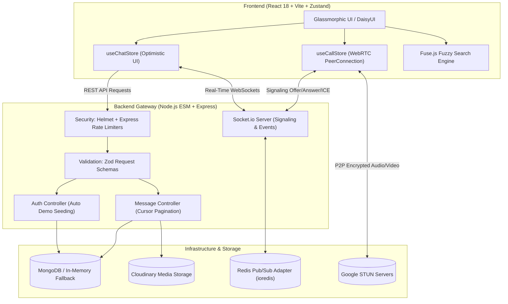

# ⚡ Chatty — Enterprise Real-Time Messaging & WebRTC Platform

<div align="center">


<p align="center">
  A production-grade, full-stack real-time collaboration platform engineered for resilience, speed, and recruiter delight. Featuring peer-to-peer WebRTC video/audio calling, optimistic UI state synchronization, cursor-paginated infinite scroll, client-side fuzzy search, and horizontal Redis scalability.
</p>

[Quickstart](#-5-second-recruiter-demo-access) • [Architecture](#-system-architecture) • [Key Features](#-core-engineering-features) • [API Contract](#-api--socket-specification) • [Testing & CI](#-testing--ci-pipeline)

</div>

---

## 🚀 5-Second Recruiter Demo Access

Test multi-user real-time Socket.io messaging and P2P WebRTC calls without registering or creating credentials:

1. **Launch Window 1 (Noby)**:
   - Navigate to `http://localhost:5173/login`.
   - Click the prominent **"Noby (Demo 1)"** one-click button.
2. **Launch Window 2 (Elsa)**:
   - Open a private / incognito window at `http://localhost:5173/login`.
   - Click the **"Elsa (Demo 2)"** one-click button.
3. **Interactive Recruiter Evaluation Points**:
   - 📞 **P2P Video Call**: Click the **Video** icon in Noby's chat header — Elsa's screen immediately rings with an animated incoming call prompt. Accept to experience bidirectional low-latency audio/video with draggable picture-in-picture (PiP), live duration timers, and mute toggles.
   - 🔍 **Instant In-Chat Fuzzy Search**: Click the **Search** icon in the header to search loaded chat messages with `Fuse.js`. Substrings highlight in real time, and clicking Next/Prev smoothly jumps to and flashes the target bubble.
   - 🎙️ **Native Voice Notes**: Tap the microphone button in the input dock to record audio using the browser `MediaRecorder` API with an animated recording timer and waveform pulse.
   - ⚡ **Optimistic UI & Read Receipts**: Send messages and watch the checkmarks transition in real time from `sending` $\to$ `delivered` (double gray check) $\to$ `read` (double blue check) upon window focus.
   - 🎨 **Theme Engine**: Switch between 30+ DaisyUI themes in **Settings** (persisted in localStorage).

---

## 🏛 System Architecture



---

## 💎 Core Engineering Features

### 1. P2P WebRTC Audio & Video Calling
- **Zero-Latency P2P Transport**: Configured with Google public STUN servers (`stun:stun.l.google.com:19302`) for resilient NAT traversal.
- **Signaling over Existing Sockets**: Seamlessly multiplexes `call:user`, `call:incoming`, `call:accepted`, `call:rejected`, `call:ended`, and `ice:candidate` across established WebSocket channels.
- **Interactive Call Stage**: Supports full-screen remote video, audio-only waveform fallback, draggable picture-in-picture local preview, mic/camera toggle controls, and live call timer.
- **Web Audio Ringtone Generator**: Synthesizes soft, dual-tone ring frequencies in pure Web Audio API without external audio file dependencies.

### 2. Client-Side Fuzzy Search (Fuse.js)
- **Typo-Tolerant Searching**: Integrated `Fuse.js` with a tuned `threshold: 0.35` for fast, client-side searching across active conversation feeds.
- **Active Bubble Jump**: Automatically tracks match counts (`Match 1 of 5`), highlights matched search substrings, and uses `scrollIntoView({ behavior: 'smooth', block: 'center' })` to focus matched bubbles with an animated glow ring.

### 3. Resilient Messaging & Optimistic UI
- **Instant Append**: Outgoing messages render immediately in the UI with a client-generated temporary ID and `status: 'sending'`.
- **Automatic Reconciliation**: Server response replaces the temporary message seamlessly. If network transmission fails, the bubble marks as `status: 'failed'` with a one-click retry trigger.
- **Read Receipts & Delivery Checks**:
  - `Clock`: Optimistic outbound transit.
  - `Check`: Stored on server (`sent`).
  - `CheckCheck` (Gray): Received by active client socket (`delivered`).
  - `CheckCheck` (Blue): Read by recipient (`read`) via focus handlers and `IntersectionObserver`.

### 4. Cursor-Based Infinite Scrolling
- **Scalable Pagination**: Backend endpoint `GET /api/messages/:id?cursor=<timestamp>&limit=30` queries indexed timestamps `{ createdAt: { $lt: cursor } }`.
- **Anchor Preservation**: When older message chunks prepend to the message stream, `prevScrollHeight - newScrollHeight` compensation prevents distracting viewport jumps.

### 5. Production Security & Architecture
- **Layered Defense**: `helmet` security headers alongside targeted `express-rate-limit` rate limiters on authentication and messaging endpoints.
- **Strict Payload Validation**: Schema-level payload sanitization using `zod` for registration, login, and message dispatches.
- **Horizontal Scalability**: Configured with `@socket.io/redis-adapter` and `ioredis`. Gracefully degrades to an in-memory adapter if `REDIS_URL` is omitted.
- **Zero-Config Database Fallback**: Auto-connects to primary MongoDB, but gracefully spins up a self-contained embedded in-memory MongoDB instance if DNS/network access is offline.

---

## 📡 API & Socket Specification

### REST Endpoints

| Method | Endpoint | Protection | Description |
| :--- | :--- | :--- | :--- |
| `POST` | `/api/auth/signup` | Public (Rate Limited) | Registers new user with Zod schema validation & JWT cookie |
| `POST` | `/api/auth/login` | Public (Rate Limited) | Authenticates user; auto-provisions Noby/Elsa demo accounts |
| `POST` | `/api/auth/logout` | Protected | Clears JWT cookie |
| `GET` | `/api/auth/check` | Protected | Returns authenticated user profile |
| `GET` | `/api/messages/users` | Protected | Returns all contacts with online status metadata |
| `GET` | `/api/messages/:id` | Protected | Retrieves conversation messages with cursor pagination support |
| `POST` | `/api/messages/send/:id` | Protected | Dispatches text, image, or base64 audio payload |
| `PATCH` | `/api/messages/read/:senderId`| Protected | Marks unread messages as read and emits real-time receipt |
| `POST` | `/api/messages/react/:messageId`| Protected | Toggles emoji reaction on target message |

### Socket.io Event Matrix

| Event Name | Direction | Payload | Purpose |
| :--- | :--- | :--- | :--- |
| `getOnlineUsers` | Server $\to$ Client | `userId[]` | Synchronizes active online contacts |
| `typing:start` / `stop` | Bidirectional | `{ receiverId / senderId }` | Debounced typing bubble indicator |
| `newMessage` | Server $\to$ Client | `Message` | Delivers real-time message to recipient |
| `messages:read` | Bidirectional | `{ senderId, readerId }` | Updates delivery checkmarks to double blue |
| `message:reaction` | Bidirectional | `{ messageId, reactions }` | Broadcasts toggled emoji reactions |
| `call:user` | Client $\to$ Server | `{ userToCall, signalData, callType }` | Initiates WebRTC call offer |
| `call:incoming` | Server $\to$ Client | `{ signal, from, callerName, callType }` | Prompts recipient call dialog |
| `call:accepted` | Bidirectional | `{ to, signal }` | Exchanges WebRTC answer description |
| `call:rejected` / `ended` | Bidirectional | `{ to }` | Cleans up media tracks and closes peer connection |
| `ice:candidate` | Bidirectional | `{ to, candidate }` | Exchanges ICE candidate routing metadata |

---

## 🧪 Testing & CI Pipeline

The backend includes a comprehensive automated test suite powered by **Jest**, **Supertest**, and **mongodb-memory-server**:

```bash
# Execute automated backend test suite
npm run test --prefix backend
```

```text
PASS tests/message.test.js
PASS tests/auth.test.js
PASS tests/middleware.test.js

Test Suites: 3 passed, 3 total
Tests:       19 passed, 19 total
Snapshots:   0 total
Time:        33.01 s
```

### GitHub Actions CI Workflow
Every push and pull request executes `.github/workflows/ci.yml`:
1. **Backend Job**: Installs dependencies and executes all 19 automated tests against an isolated in-memory MongoDB environment.
2. **Frontend Job**: Verifies zero ESLint rule violations and verifies the production Vite distribution bundle.

---

## 🛠 Local Setup & Installation

### Prerequisites
- Node.js `v18+` or `v20+`
- npm `v9+`

### 1. Clone & Install Dependencies
```bash
git clone https://github.com/your-username/fullstack-chat-app.git
cd fullstack-chat-app

# Install backend dependencies
cd backend && npm install

# Install frontend dependencies
cd ../frontend && npm install
```

### 2. Configure Environment (`.env`)

**`backend/.env`**:
```env
PORT=5001
MONGODB_URI=mongodb+srv://<username>:<password>@cluster.mongodb.net/chat_db
JWT_SECRET=your_super_secret_jwt_key
CLOUDINARY_CLOUD_NAME=your_cloud_name
CLOUDINARY_API_KEY=your_cloudinary_key
CLOUDINARY_API_SECRET=your_cloudinary_secret
NODE_ENV=development

# Optional for horizontal scaling:
# REDIS_URL=redis://localhost:6379
```

**`frontend/.env`**:
```env
VITE_API_URL=http://localhost:5001/api
VITE_SOCKET_URL=http://localhost:5001
```

### 3. Run Development Servers
```bash
# In terminal 1: Start backend
cd backend && npm run dev

# In terminal 2: Start frontend
cd frontend && npm run dev
```

Visit `http://localhost:5173` to experience the platform.
